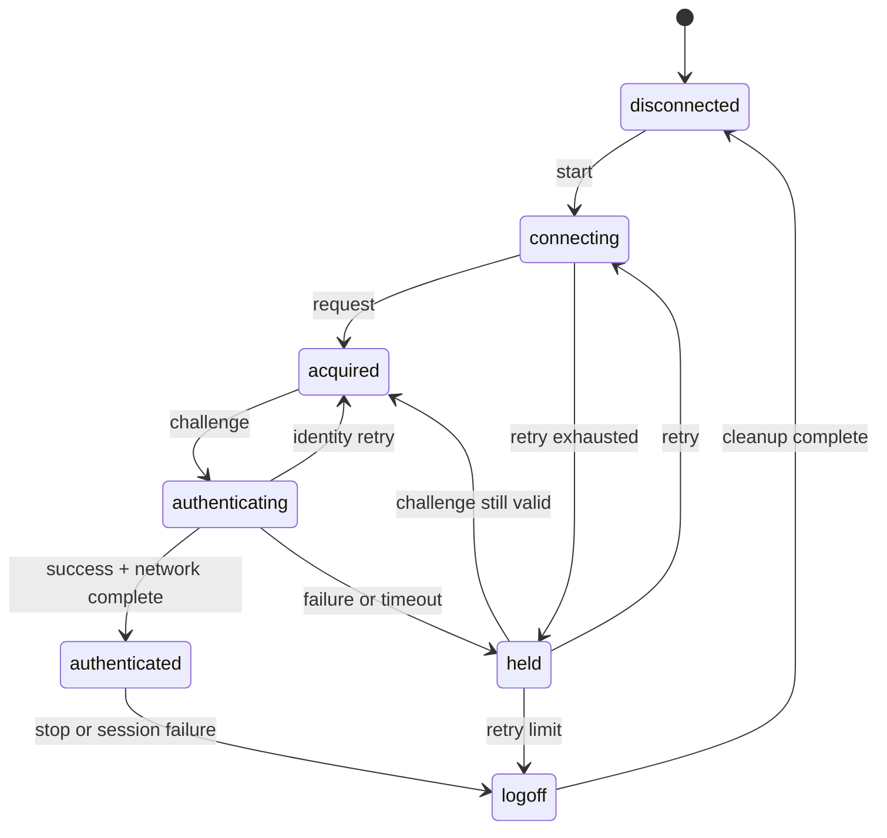

# 认证状态机与 DHCP 第二认证

本页把 EAP 交换、网络完成和会话终止统一为一个状态机。实现者应以状态和会话参数判断事件，不依赖 GUI 提示或日志文本。

## 状态定义

| 数值 | 状态           | 含义                                        |
| ---- | -------------- | ------------------------------------------- |
| `1`  | disconnected   | 无认证会话                                  |
| `2`  | connecting     | 正在等待服务器 Start 响应                   |
| `3`  | acquired       | 已获得服务器和 EAP identifier，正在提交身份 |
| `4`  | authenticating | 已收到 challenge，正在提交认证响应          |
| `5`  | authenticated  | EAP 成功且网络完成步骤通过                  |
| `6`  | held           | 认证失败或超时，等待退避重试                |
| `7`  | logoff         | 会话终止，清理网络与直接通信资源            |

每次状态切换都必须携带会话代次。旧代次的 EAP 帧、DHCP 定时器和直接通信响应不得推进新状态。

## 初始与连接阶段

进入 connecting 时，客户端保存当前源 MAC，建立目的 MAC，并把尝试计数加一。随后发送 EAPOL Start。

客户端接受以下连接阶段事件：

| 事件                      | 条件               | 下一状态   |
| ------------------------- | ------------------ | ---------- |
| 有效 EAP Request/Identity | identifier 可保存  | acquired   |
| Start 定时器到期          | 尝试数小于策略上限 | connecting |
| Start 定时器到期          | 尝试数达到上限     | held       |

每次进入 connecting 都清空 challenge、认证标志和上一次请求的 identifier。服务器返回的目的 MAC 可由当前 NAS 地址替换默认组播地址。

## 身份与 challenge 阶段

acquired 阶段发送 Identity Response。收到 MD5-Challenge Request 时，客户端原子保存 EAP identifier、challenge 长度和 challenge 字节，然后进入 authenticating。

服务器再次请求 Identity 时，客户端返回 acquired。认证阶段收到新的 challenge 时，必须用新值替换旧值，不得只替换 identifier。

进入 authenticating 后构造 MD5 Response。响应格式见 [EAPOL 与 EAP 报文](eap.md)。

## Success 与网络完成

收到 EAP Success 后，客户端先清理 EAP 计时器，再判断网络完成方式：

| 条件                                           | 网络完成动作                               |
| ---------------------------------------------- | ------------------------------------------ |
| 不走 DHCP 第二认证                             | 直接进入 authenticated                     |
| 有线、EAP-MD5、锐捷 NAS、DHCP 开启，阶段为首次 | 执行 DHCP 后重启 EAP                       |
| PEAP 或需要地址确认的路径                      | 获取地址，建立直接会话，等待 DHCP 认证结果 |

只有网络完成动作成功后才进入 authenticated。EAP Success 本身不证明客户端已经获得可用地址。

## DHCP 第二认证

DHCP 第二认证只适用于有线 EAP-MD5、锐捷 NAS 和 DHCP 启用同时成立的会话。阶段字段保存为：

| 阶段 | 含义                              |
| ---- | --------------------------------- |
| `0`  | 当前路径不使用第二认证            |
| `1`  | 第一次 EAP 已完成，等待 DHCP 地址 |
| `2`  | 地址已获得，第二次 EAP 即将开始   |

首次 EAP Response 携带私有字段 `0x63=1`。EAP Success 后启动 DHCP 客户端，并每 2 秒检查地址和默认网关。

检查成功的处理顺序如下：

1. 停止 DHCP 轮询。
2. 保存 IP、掩码、网关和 DNS。
3. 把阶段改为 `2`。
4. 重启 EAP 状态机并重新发送 Start。
5. 第二次 EAP Response 携带 `0x63=2`。
6. 第二次 EAP Success 后直接进入 authenticated。

连续 21 次轮询没有同时获得地址和网关时，终止认证并记录 DHCP 获取失败。已经获得地址但缺少网关不得被视为成功。

## 直接通信与 DHCP 结果

PEAP 路径在获得地址后建立 SAM 或 SMP 会话，并发送 IP 和主机信息。用户信息发送成功后启动 9 秒结果计时器。

服务器通过 SAM 或 SMP 返回成功标志和可选文本：

| 结果                 | 动作                               |
| -------------------- | ---------------------------------- |
| 成功标志为真         | 取消结果计时器，进入 authenticated |
| 成功标志为假且有文本 | 显示服务器文本并进入 logoff        |
| 成功标志为假且无文本 | 以结果超时语义进入 logoff          |
| 9 秒内没有结果       | 取消会话并进入 logoff              |

直接通信载荷中的结果字段见 [SAM/SMP 直接通信](direct.md)。

## PEAP 路径

服务器选择 EAP type `25` 时，客户端建立 PEAP 外层 TLS 会话。服务器证书必须通过调用方配置的信任策略；认证器不得跳过证书链校验。

TLS 隧道内按服务器协商结果执行内层认证。锐捷扩展常见路径使用 MSCHAPv2，用户名和密码使用调用方提供的凭据。PEAP 的私有字段使用紧凑容器，口令字段 `0x5f` 使用固定起始值，V3 摘要字段 `0x60` 使用与 EAP-MD5 相同的五模式构造。

外层 PEAP Success 后，客户端获取 IPv4 地址并启动直接通信。服务器可以在隧道内下发 SAM/SMP 端口、地址、最大版本和其他会话参数；这些参数必须在内层认证完成前保存到独立候选状态。

## Held 与重试

held 保存失败原因和 holding 时长。每次进入 held 增加失败计数，并启动 held 计时器。

held 到期时：

- 若 identity 阶段尚未完成，返回 connecting。
- 若 challenge 仍在有效期内，返回 acquired。
- 失败计数超过策略阈值时，设置用户下线标志并进入 logoff。

held 不得复用过期的 challenge。服务器明确返回 Failure 后，当前 challenge 必须作废。

## Logoff 与资源清理

logoff 阶段必须执行以下动作：

1. 停止 connecting、auth、held、DHCP 和直接结果计时器。
2. 关闭 SAM/SMP 发送器与分片接收缓冲。
3. 清除 key、IV、challenge、会话 ID 和当前 identifier。
4. 在尚未终态时发送 EAPOL Logoff。
5. 转入 disconnected，等待下一次显式启动。

清理步骤必须幂等。重复收到服务器 Logoff、重认证请求或本地停止命令时，不得重复引用已经释放的会话。

## 本地失败原因

以下编号用于本地诊断，不进入线上报文：

| 编号    | 条件                                      |
| ------- | ----------------------------------------- |
| `0x75`  | 服务器 DHCP 认证结果明确失败              |
| `0x3eb` | 用户信息未能发送到 SAM/SMP 服务器         |
| `0x3ec` | 直接通信 DHCP 认证结果为空或 9 秒内未返回 |
| `0x3ed` | DHCP 地址获取或轮询失败                   |

服务器文本只作为展示数据。认证器不得根据文本内容推断成功或失败，成功判定必须使用结构化结果字段。
