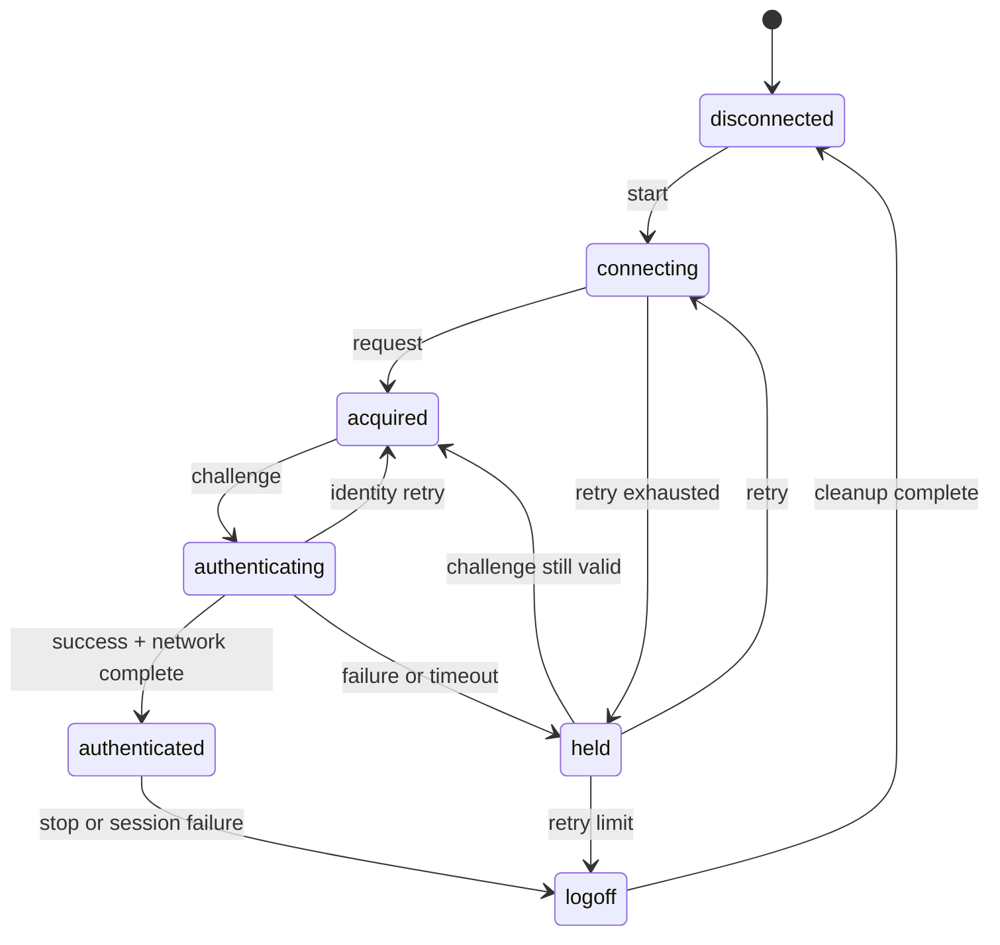

# 认证状态机与 DHCP 第二认证

本页把 EAP 交换、网络完成和会话终止统一为一个状态机。实现者应以状态和会话参数判断事件，不依赖 GUI 提示或日志文本。

本页未标记的状态、转移和固定条件属于[第 1 类已证明事实](scope.md#信息分类)。当前时间、输入帧、DHCP 租约和 TLS 结果属于第 2 类 client 输入，用途与获取方式在对应章节就地说明。

## 状态定义

| 数值 | 状态           | 含义                                        |
| ---- | -------------- | ------------------------------------------- |
| `1`  | disconnected   | 无认证会话                                  |
| `2`  | connecting     | 正在等待服务器 Start 响应                   |
| `3`  | acquired       | 已获得服务器和 EAP identifier，正在提交身份 |
| `4`  | authenticating | 已收到 challenge，正在提交认证响应          |
| `5`  | authenticated  | EAP 成功且网络完成步骤通过                  |
| `6`  | held           | 认证失败或超时，等待退避重试                |
| `7`  | logoff         | 会话终止，清理网络与直接通信资源            |

每次状态切换都必须携带会话代次。旧代次的 EAP 帧、DHCP 定时器和直接通信响应不得推进新状态。

### Client 输入：当前时间

| 信息  | 布局                             |
| ----- | -------------------------------- |
| `now` | 单调不减的绝对时间戳，单位为纳秒 |

用途：判断 Start、认证、held、DHCP 轮询和 Direct 结果计时器是否到期，并为旧代次输入提供先后顺序。

client 获取方式：读取单调时钟或由外部测试驱动的单调时间源，在每次调用 `step` 时传入；同一会话内不得回退。

## 初始与连接阶段

进入 connecting 时，客户端保存当前源 MAC，建立目的 MAC，并把尝试计数加一。随后发送 EAPOL Start。

客户端接受以下连接阶段事件：

| 事件                      | 条件               | 下一状态   |
| ------------------------- | ------------------ | ---------- |
| 有效 EAP Request/Identity | identifier 可保存  | acquired   |
| Start 定时器到期          | 尝试数小于策略上限 | connecting |
| Start 定时器到期          | 尝试数达到上限     | held       |

每次进入 connecting 都清空 challenge、认证标志和上一次请求的 identifier。服务器返回的目的 MAC 可由当前 NAS 地址替换默认组播地址。

## 身份与 challenge 阶段

acquired 阶段发送 Identity Response。收到 MD5-Challenge Request 时，客户端原子保存 EAP identifier、challenge 长度和 challenge 字节，然后进入 authenticating。

服务器再次请求 Identity 时，客户端返回 acquired。认证阶段收到新的 challenge 时，必须用新值替换旧值，不得只替换 identifier。

进入 authenticating 后构造 MD5 Response。响应格式见 [EAPOL 与 EAP 报文](eap.md)。

## Success 与网络完成

收到 EAP Success 后，客户端先清理 EAP 计时器，再判断网络完成方式：

| 条件                                           | 网络完成动作                               |
| ---------------------------------------------- | ------------------------------------------ |
| 不走 DHCP 第二认证                             | 直接进入 authenticated                     |
| 有线、EAP-MD5、锐捷 NAS、DHCP 开启，阶段为首次 | 执行 DHCP 后重启 EAP                       |
| PEAP 或需要地址确认的路径                      | 获取地址，建立直接会话，等待 DHCP 认证结果 |

只有网络完成动作成功后才进入 authenticated。EAP Success 本身不证明客户端已经获得可用地址。

标准 EAP Success 只有 code、identifier 和 length，没有 EAP type/data。锐捷扩展可以在 EAPOL 帧后附加私有字段；Linux 1.31 将这些字段解析到独立的 `SuRadiusPrivate` 上下文。Success code 是进入网络完成和 Direct 初始化的触发器，不代表 Direct 端点、key、IV 或服务类型都编码在 Success 的 `code=3` 中。

Direct 交接至少组合三类输入：

1. 服务器私有上下文，例如 RADIUS 服务类型、对端地址和端口、本地端口覆盖值、DES key/IV、UTC 和服务周期。
2. 本机网络事实，例如 DHCP 得到的 IPv4、掩码、网关、DNS 和认证适配器 MAC。
3. 本机软件事实，例如用户名、硬盘序列号、版本和可选安全字段。

Linux 1.31 在 authenticated 处理中调用 `StartDirectTrans`，再按 RADIUS 服务类型 `9` 或 `5` 选择 SAM 或 SMP。MentoHUST 的旧 Echo 路径则是另一种部署兼容分支，不能用来否定官方客户端的 Direct 路径，也不能反过来把所有 EAP-MD5 部署都强制成 SAM/SMP。

> 当前 Zig 代码暂不实施：旧 Echo 心跳兼容分支。当前主线为 SAM/SMP Direct。

## DHCP 第二认证

DHCP 第二认证只适用于有线 EAP-MD5、锐捷 NAS 和 DHCP 启用同时成立的会话。阶段字段保存为：

| 阶段 | 含义                              |
| ---- | --------------------------------- |
| `0`  | 当前路径不使用第二认证            |
| `1`  | 第一次 EAP 已完成，等待 DHCP 地址 |
| `2`  | 地址已获得，第二次 EAP 即将开始   |

首次 EAP Response 携带私有字段 `0x63=1`。EAP Success 后启动 DHCP 客户端，并每 2 秒检查地址和默认网关。

检查成功的处理顺序如下：

1. 停止 DHCP 轮询。
2. 保存 IP、掩码、网关和 DNS。
3. 把阶段改为 `2`。
4. 重启 EAP 状态机并重新发送 Start。
5. 第二次 EAP Response 携带 `0x63=2`。
6. 第二次 EAP Success 后直接进入 authenticated。

连续 21 次轮询没有同时获得地址和网关时，终止认证并记录 DHCP 获取失败。已经获得地址但缺少网关不得被视为成功。

### Client 输入：DHCP 租约

| 信息      | 布局                                                         |
| --------- | ------------------------------------------------------------ |
| DHCP 租约 | IPv4 地址、子网掩码、默认网关和 DNS，各 4 字节；可选备用 DNS |

用途：完成 DHCP 第二认证，并为 SAM/SMP 用户信息和 Direct 网络参数提供本机网络事实。

client 获取方式：由系统的 DHCP 客户端或网络管理 API 提供当前认证网卡的有效租约；只有在地址和默认网关同时存在时才能提交为成功。

## 直接通信与 DHCP 结果

在服务器通过 RADIUS 服务类型选择 SAM 或 SMP 的 PEAP、EAP-MD5 路径中，客户端在获得地址后建立 Direct 会话并发送 IP 和主机信息。用户信息发送成功后启动 9 秒结果计时器。

服务器通过 SAM 或 SMP 返回成功标志和可选文本：

| 结果                 | 动作                               |
| -------------------- | ---------------------------------- |
| 成功标志为真         | 取消结果计时器，进入 authenticated |
| 成功标志为假且有文本 | 显示服务器文本并进入 logoff        |
| 成功标志为假且无文本 | 以结果超时语义进入 logoff          |
| 9 秒内没有结果       | 取消会话并进入 logoff              |

直接通信载荷中的结果字段见 [SAM/SMP 直接通信](direct.md)。Direct 初始化所需的精确字段来源、消息关联 ID 和本地端口回退见同页“ID 分配与重发”和“端口、时间戳与本地回退”。

## PEAP 路径

服务器选择 EAP type `25` 时，客户端建立 PEAP 外层 TLS 会话。服务器证书必须通过 client 的部署 profile 和 TLS 适配层验证；认证器不得跳过证书链校验。

TLS 隧道内按服务器协商结果执行内层认证。锐捷扩展常见路径使用 MSCHAPv2，用户名和密码由 client 提供。PEAP 的私有字段使用紧凑容器，口令字段 `0x5f` 使用固定起始值，V3 摘要字段 `0x60` 使用与 EAP-MD5 相同的五模式构造。

> TODO（后续版本可选补齐调查）：PEAPv1、PEAPv2 和 cryptobinding。

外层 PEAP Success 后，客户端获取 IPv4 地址并启动直接通信。服务器可以在隧道内下发 SAM/SMP 端口、地址、最大版本和其他会话参数；这些参数必须在内层认证完成前保存到独立候选状态。

### Client 输入：PEAP TLS

| 信息          | 布局                              |
| ------------- | --------------------------------- |
| TLS 输入/输出 | 不含 EAP 外层的连续 TLS 记录字节  |
| TLS 验证结果  | 成功，或类型化的证书/主机身份失败 |

用途：推进 PEAP 握手和记录保护；验证结果决定是否允许继续内层认证。

client 获取方式：由 client 的 TLS engine 处理服务器 TLS 字节、产生待发送字节，并根据部署 profile 中的 CA、服务器身份和最低 TLS 版本返回验证结果。

客户端应验证的服务器身份来源可以静态来自部署 profile，但真实校园网使用的 DNS 名称、IP、证书链、公钥指纹和协商 TLS 版本只能从实际 TLS 握手确认。

Linux 1.31 的构建事实已经确认：`tls_init` 使用 `TLSv1_method()` 创建 SSL context，并支持 `ca_cert`、`ca_path` 与连接级证书验证回调。该证据证明客户端库具备 TLS 1.0 系列协议能力和 CA 链验证入口，不证明目标服务器实际提供的证书、主机身份字段或最终协商版本。

> 运行调查（认证期）：认证期需记录服务器证书 DER、证书链、Subject/SAN、有效期、指纹和协商 TLS 版本，并由部署方确认信任锚与主机身份规则。静态不能替代这些值，因为证书由目标服务器在握手时提供，客户端构建只证明验证入口和能力。

### Client 输入：MSCHAPv2

| 信息               | 布局                               |
| ------------------ | ---------------------------------- |
| MSCHAPv2 响应      | 标准 EAP-MSCHAPv2 Response payload |
| 成功认证器校验结果 | 通过或失败                         |

用途：完成隧道内凭据认证，并验证服务器是否持有对应的凭据派生值。

client 获取方式：由 client 的 MSCHAPv2 provider 使用用户凭据和服务器 challenge 计算响应，并在认证器到达时返回校验结果。

Linux 1.31 内嵌 wpa_supplicant 的 `nt_password_hash` 已静态确认：输入是原始密码字节，最多使用 256 字节；每个字节直接放入一个 UTF-16LE code unit 的低字节，高字节写零。该实现不解码 UTF-8/GBK，不做 Unicode 规范化，也不处理代理项。`mschapv2_derive_response` 将密码指针和长度原样传给该函数。

因此中文密码的结果完全取决于 upstream 传入的字节编码；UTF-8 或 GBK 多字节序列都会被逐字节当成独立 UTF-16 code unit。

macOS 1.35 主程序只表明 PEAP 依赖系统 Security/CoreWLAN 能力，未内嵌 `nt_password_hash` 或 MSCHAPv2 provider 实现。Windows 6.85 的 `SuEapPeerPeap32.dll`/`SuEapPeerPeap64.dll` 是 EAPHost 代理壳，通过固定命名管道 `\\.\pipe\RJ_WLAN_PEAR_EAP_METHOD_P_@20110111@` 委托给 `SuEapPeap.dll`；代理 DLL 本身没有直接导入 MD4 或密码哈希实现。

Windows 自解压包、`Setup_x86.zip`、安装归档、`SuInstaller.exe`、`SuInstallerInterface.dll` 和 `8021x.exe` 的命名资源均未提供 `SuEapPeap.dll`。`8021x.exe` 内部另含 `CEapPEAPThread`、MSCHAPv2 路径和 MD4 实现，但静态不能证明目标部署选择这条内部路径而不使用 EAPHost provider。因此不能把 Linux 的逐字节规则外推到 macOS 或 Windows。

> 运行调查（认证期）：在目标 Windows 和 macOS 部署上使用中文密码完成一次 PEAP/MSCHAPv2 认证，记录实际 provider 路径和 UTF-16LE NT password hash 输入材料；Windows 若在安装目录找到 `SuEapPeap.dll`，须先按 SHA-256 绑定版本并静态复核，再做认证期验证。静态不能唯一确定，因为 Windows 实际 provider 缺失，macOS 实现在系统框架内，且两条路径的字符集和规范化行为都不可由主程序推定。

确定性实现不应自行猜测缺失的服务器值。可由服务器字段、DHCP 结果和本机适配器权威导出的值应在协议层组合；时间起点、是否真实绑定本地端口、TLS 证书策略和平台 I/O 仍由 client adapter 提供。

Direct 构造输入应按下述所有权收口：

- 服务器上下文：RADIUS 服务类型、对端地址和端口、本地端口覆盖、DES key/IV、UTC、心跳和重认证周期。
- DHCP/适配器事实：IPv4、掩码、网关、DNS 和认证 MAC。
- 本机软件事实：用户名、主机硬盘序列号、客户端名称、版本和可选安全字段。
- 平台 I/O：socket 生命周期、TLS provider、本地时钟和 adapter 收发包。

当前原型仍要求 client 提交固定的 Direct 语义配置，这是待修正的实现边界，不是官方客户端没有本地回退值。

Linux 1.31、macOS 1.35 和 Windows 6.85 的 Direct 端口回退均为对端 `8080`、本地 `80`。Linux 在服务器 UTC 缺失时使用本地单调时间模式。

Windows 6.85 的 Direct 时间戳管理器创建时使用空表；空表查询返回 `0`，已有记录首次递增后的值为 `1`。其 `0x55` 编码器固定返回空值，`0x64` 只在 IPD 客户端检测状态成立时发送固定 `00 01`，其他字段的生成条件已按平台记录在[私有字段布局](private-fields.md)。这些静态结论仍不等于目标服务器要求的最小字段集合。

> 运行调查（认证期）：认证期记录目标 PEAP 路径实际发送的 `0x17`、`0x39`、`0x55`、`0x64`、客户端名称/版本和 IPv6 字段，以及服务器返回的私有参数；再用成功与拒绝结果确认最小必需集合。静态不能唯一确定，因为各平台编码器提供的是可选发送机制，服务器接受策略属于目标部署。

> 当前 Zig 代码暂不实施：TLS 握手、证书验证、证书读取和 socket 生命周期。client 提交 TLS 字节、建立状态及验证结果。

> 当前 Zig 代码暂不实施：MSCHAPv2 密码学计算和成功认证器校验。client 负责计算并返回结构化结果。

## Held 与重试

held 保存失败原因和 holding 时长。每次进入 held 增加失败计数，并启动 held 计时器。

held 到期时：

- 若 identity 阶段尚未完成，返回 connecting。
- 若 challenge 仍在有效期内，返回 acquired。
- 失败计数超过策略阈值时，设置用户下线标志并进入 logoff。

held 不得复用过期的 challenge。服务器明确返回 Failure 后，当前 challenge 必须作废。

## Logoff 与资源清理

logoff 阶段必须执行以下动作：

1. 停止 connecting、auth、held、DHCP 和直接结果计时器。
2. 关闭 SAM/SMP 发送器与分片接收缓冲。
3. 清除 key、IV、challenge、Direct correlation ID、片段计数器和当前 identifier。
4. 在尚未终态时发送 EAPOL Logoff。
5. 转入 disconnected，等待下一次显式启动。

清理步骤必须幂等。重复收到服务器 Logoff、重认证请求或本地停止命令时，不得重复引用已经释放的会话。

## 本地失败原因

以下编号用于本地诊断，不进入线上报文：

| 编号    | 条件                                      |
| ------- | ----------------------------------------- |
| `0x75`  | 服务器 DHCP 认证结果明确失败              |
| `0x3eb` | 用户信息未能发送到 SAM/SMP 服务器         |
| `0x3ec` | 直接通信 DHCP 认证结果为空或 9 秒内未返回 |
| `0x3ed` | DHCP 地址获取或轮询失败                   |

服务器文本只作为展示数据。认证器不得根据文本内容推断成功或失败，成功判定必须使用结构化结果字段。
