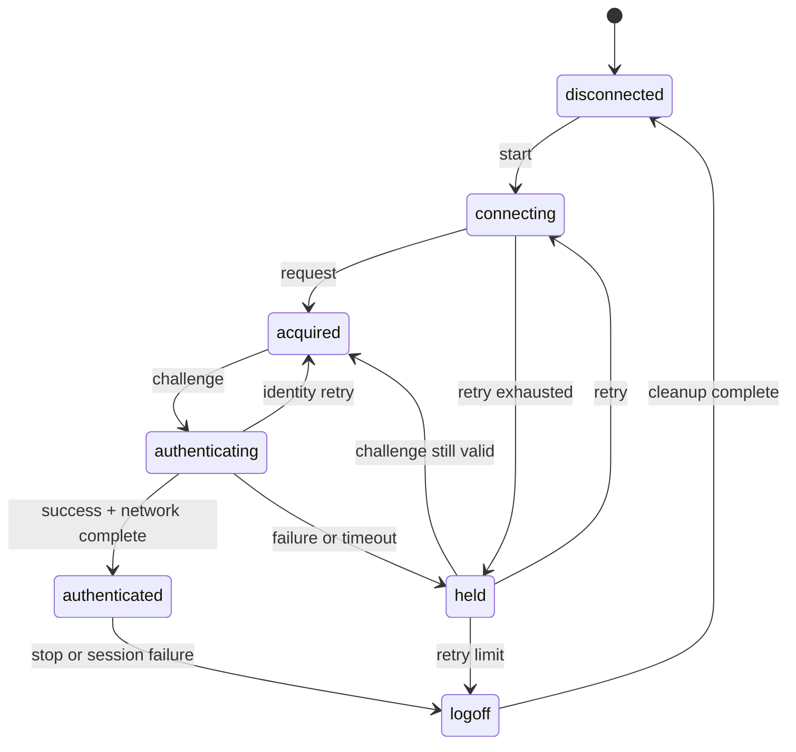

# 认证状态机与 DHCP 第二认证

本页定义 EAP 交换、网络完成与会话终止的状态关系。状态由协议事件及会话参数确定。

本页未标记的状态、转移和固定条件属于[第 1 类已证明事实](scope.md#信息分类)。当前时间、输入帧、DHCP 租约和 TLS 结果属于第 2 类 client 输入，用途与获取方式在对应章节就地说明。

## 状态定义

[完整状态机图](flow_chart.svg)展示 EAP-MD5、PEAP、DHCP 第二认证和 SAM/SMP 的分支关系。下图给出七个主状态的投影；两图均以本页及[直接通信](direct.md)的定义为依据。

| 数值 | 状态           | 含义                                        |
| ---- | -------------- | ------------------------------------------- |
| `1`  | disconnected   | 无认证会话                                  |
| `2`  | connecting     | 正在等待服务器 Start 响应                   |
| `3`  | acquired       | 已获得服务器和 EAP identifier，正在提交身份 |
| `4`  | authenticating | 已收到 challenge，正在提交认证响应          |
| `5`  | authenticated  | EAP 成功且网络完成步骤通过                  |
| `6`  | held           | 认证失败或超时，等待退避重试                |
| `7`  | logoff         | 会话终止，清理网络与直接通信资源            |



状态转移仅接受当前会话的事件。已终止会话的 EAP 帧、DHCP 超时与 Direct 响应不推进新会话。

### Client 输入：当前时间

| 信息  | 布局                 |
| ----- | -------------------- |
| `now` | 单调不减的本地时间值 |

用途：确定 Start、认证、held、DHCP 轮询与 Direct 结果等待的时间边界。

client 获取方式：读取本机单调时钟；同一会话内时间不得回退。

## 初始与连接阶段

进入 connecting 时，客户端保存当前源 MAC，建立目的 MAC，并把尝试计数加一。随后发送 EAPOL Start。

客户端接受以下连接阶段事件：

| 事件                      | 条件               | 下一状态   |
| ------------------------- | ------------------ | ---------- |
| 有效 EAP Request/Identity | identifier 可保存  | acquired   |
| Start 定时器到期          | 尝试数小于策略上限 | connecting |
| Start 定时器到期          | 尝试数达到上限     | held       |

每次进入 connecting 都清空 challenge、认证标志和上一次请求的 identifier。服务器返回的目的 MAC 可由当前 NAS 地址替换默认组播地址。

## 身份与 challenge 阶段

acquired 阶段发送 Identity Response。收到 MD5-Challenge Request 时，客户端原子保存 EAP identifier、challenge 长度和 challenge 字节，然后进入 authenticating。

服务器再次请求 Identity 时，客户端返回 acquired。认证阶段收到新的 challenge 时，必须用新值替换旧值，不得只替换 identifier。

进入 authenticating 后构造 MD5 Response。响应格式见 [EAPOL 与 EAP 报文](eap.md)。

## Success 与网络完成

收到 EAP Success 后，客户端先清理 EAP 计时器，再判断网络完成方式：

| 条件                                           | 网络完成动作                               |
| ---------------------------------------------- | ------------------------------------------ |
| 不走 DHCP 第二认证                             | 直接进入 authenticated                     |
| 有线、EAP-MD5、锐捷 NAS、DHCP 开启，阶段为首次 | 执行 DHCP 后重启 EAP                       |
| PEAP 或需要地址确认的路径                      | 获取地址，建立直接会话，等待 DHCP 认证结果 |

只有网络完成动作成功后才进入 authenticated。EAP Success 本身不证明客户端已经获得可用地址。

标准 EAP Success 只有 code、identifier 和 length，没有 EAP type；但锐捷扩展可以在 Success 的 EAP length 内附加私有固定段（见[锐捷私有字段](private-fields.md#服务器固定段)），因此 Success 的 length 可以大于 4。客户端必须按完整 EAP length 接收 Success，不能把它当成只有 4 字节的终端。Success code 是进入网络完成和 Direct 初始化的触发器，不代表 Direct 端点、key、IV 或服务类型都编码在 Success 的 `code=3` 中。

Direct 交接至少组合三类输入：

1. 服务器私有上下文，例如 RADIUS 服务类型、对端地址和端口、本地端口覆盖值、DES key/IV、UTC 和服务周期。
2. 本机网络事实，例如 DHCP 得到的 IPv4、掩码、网关、DNS 和认证适配器 MAC。
3. 本机软件事实，例如用户名、硬盘序列号、版本和可选安全字段。

Linux 1.31 在 authenticated 阶段按 RADIUS 服务类型 `9` 或 `5` 选择 SAM 或 SMP。MentoHUST 的旧 Echo 路径则是另一种部署兼容分支，不能用来否定官方客户端的 Direct 路径，也不能反过来把所有 EAP-MD5 部署都强制成 SAM/SMP。

macOS 1.35 的一个 EAP-MD5 会话在 Success 后保持有效地址，已知交换中不含 SAM/SMP Direct 报文。该结论限于此会话，不能单凭 EAP 方法与 Success 确定 Direct 已启动。

> TODO （后续版本可选实施）：旧 Echo 心跳兼容分支。

## DHCP 第二认证

DHCP 第二认证只适用于有线 EAP-MD5、锐捷 NAS 和 DHCP 启用同时成立的会话。Linux 1.31 路径使用以下阶段：

| 阶段 | 含义                              |
| ---- | --------------------------------- |
| `0`  | 当前路径不使用第二认证            |
| `1`  | 第一次 EAP 已完成，等待 DHCP 地址 |
| `2`  | 地址已获得，第二次 EAP 即将开始   |

Linux 首次 EAP Response 携带私有字段 `0x63=1`。EAP Success 后启动 DHCP 客户端，并每 2 秒检查地址和默认网关。

检查成功的处理顺序如下：

1. 停止 DHCP 轮询。
2. 保存 IP、掩码、网关和 DNS。
3. 把阶段改为 `2`。
4. 重启 EAP 状态机并重新发送 Start。
5. 第二次 EAP Response 携带 `0x63=2`。
6. 第二次 EAP Success 后直接进入 authenticated。

连续 21 次轮询没有同时获得地址和网关时，终止认证并记录 DHCP 获取失败。已经获得地址但缺少网关不得被视为成功。

macOS 1.35 的一组 EAP-MD5 成功交换不携带 `0x63`，且不含第二次 EAP。该字段不是所有平台首轮响应的共同要求。

### Client 输入：DHCP 租约

| 信息      | 布局                                                         |
| --------- | ------------------------------------------------------------ |
| DHCP 租约 | IPv4 地址、子网掩码、默认网关和 DNS，各 4 字节；可选备用 DNS |

用途：完成 DHCP 第二认证，并为 SAM/SMP 用户信息和 Direct 网络参数提供本机网络事实。

client 获取方式：由系统的 DHCP 客户端或网络管理 API 提供当前认证网卡的有效租约；只有在地址和默认网关同时存在时才能提交为成功。

## 直接通信与 DHCP 结果

在服务器通过 RADIUS 服务类型选择 SAM 或 SMP 的 PEAP、EAP-MD5 路径中，客户端在获得地址后建立 Direct 会话并发送 IP 和主机信息。用户信息发送成功后启动 9 秒结果计时器。

服务器通过 SAM 或 SMP 返回成功标志和可选文本：

| 结果                 | 动作                               |
| -------------------- | ---------------------------------- |
| 成功标志为真         | 取消结果计时器，进入 authenticated |
| 成功标志为假且有文本 | 显示服务器文本并进入 logoff        |
| 成功标志为假且无文本 | 以结果超时语义进入 logoff          |
| 9 秒内没有结果       | 取消会话并进入 logoff              |

直接通信载荷中的结果字段见 [SAM/SMP 直接通信](direct.md)。Direct 初始化所需的精确字段来源、消息关联 ID 和本地端口回退见同页“ID 分配与重发”和“端口、时间戳与本地回退”。

## PEAP 路径

服务器选择 EAP type `25` 时，客户端建立 PEAP 外层 TLS 会话。服务器证书的信任锚与身份约束由部署 profile 确定，认证成功以证书链及身份验证通过为前提。

TLS 隧道内按服务器协商结果执行内层认证。锐捷扩展常见路径使用 MSCHAPv2，用户名和密码由 client 提供。PEAP 的私有字段使用紧凑容器，口令字段 `0x5f` 使用固定起始值，V3 摘要字段 `0x60` 使用与 EAP-MD5 相同的五模式构造。

### PEAP 版本协商

PEAP 请求的第一个 TLS 应用数据字节包含 `flags`。低 3 位是服务器支持的 PEAP 版本：

```text
server_version = flags & 0x07
if server_version < own_version:
    own_version = server_version
if forced_version >= 0 and forced_version != own_version:
    fail
```

Linux 1.31 的 `eap_peap_data` 默认 `peap_version = 1`、`force_peap_version = -1`。配置字符串
`peapver=N` 同时设置当前版本和强制版本；强制值不能与服务器协商结果不同。客户端生成的 Linux 无线
profile 没有 `peapver`，所以当前随包路径的客户端上限是 PEAPv1，服务器可以把双方降为 PEAPv0，
不能协商到 PEAPv2。嵌入式实现本身支持强制 PEAPv2。

PEAPv0/v1 的 TLS 内层载荷直接以 EAP 帧开始。PEAPv2 必须把内层 EAP 帧封装为 EAP-Payload TLV：

```text
tlv_type = 0x8009
length   = u16be(inner EAP length)
value    = complete inner EAP packet
```

客户端检查 TLV 长度、内层 EAP header 长度和完整数据长度三者一致；不足、溢出或长度不一致均终止
本次内层认证。

PEAPv1 的隧道内 EAP-Success 可以用三种兼容策略结束：

| `peap_outer_success` | 行为                                  |
| -------------------- | ------------------------------------- |
| `0`                  | 收到隧道内 EAP-Success 后立即结束认证 |
| `1`                  | 再发送一个隧道内 EAP-Success          |
| `2`                  | 发送 PEAP/TLS ACK 完成认证            |

Linux 1.31 默认值是 `2`。这里的 Success 处理只属于 PEAP 隧道，不是用外层 EAP Success 跳过内层认证。

### Cryptobinding

Linux 1.31 支持 `crypto_binding=0/1/2`，分别为禁用、可选和必需；默认是可选。Cryptobinding
TLV 在 TLS 明文中使用 type `0x000c`，PEAPv2 使用带 mandatory 位的 `0x800c`；长度固定为
`0x0038`，即 56 字节 value，完整 TLV 为 60 字节。

该客户端生成的 TLV value 为：

| 偏移   | 长度 | 值                                   |
| ------ | ---- | ------------------------------------ |
| `0x00` | 1    | `0x00`                               |
| `0x01` | 1    | 当前 PEAP version                    |
| `0x02` | 1    | 当前 PEAP version                    |
| `0x03` | 1    | `0x01`，response subtype             |
| `0x04` | 32   | `binding_nonce`                      |
| `0x24` | 20   | `compound_mac`，计算前为 20 个零字节 |

接收服务器 request TLV 时，客户端要求 value 的偏移 `0x01` 等于协商 PEAP version，偏移 `0x03`
为 `0x00`（request subtype）；TLV 总长、version 或 subtype 不符都会终止认证。若
`crypto_binding=2` 而内层成功消息没有 Cryptobinding TLV，也必须失败。

`compound_mac` 的输入和密钥为：

```text
mac_input = complete_cryptobinding_TLV[60] || eap_type:u8
compound_mac = HMAC-SHA1(cmk[20], mac_input)
eap_type = 25
```

计算时 TLV 中的 MAC 区保持为零，随后把得到的 20 字节 HMAC 写入该区。密钥派生为：

```text
isk = phase2_getKey() 的 32 字节结果；
      否则取 TLS key block 以 "client PEAP encryption"
      导出的 64 字节结果中的前 32 字节
imck[60] = PRF+(peap_version, tk[40], "Inner Methods Compound Keys", isk[32])
ipmk[40] = imck[0..40]
cmk[20]  = imck[40..60]
```

接收端使用常量长度检查和完整 HMAC-SHA1 比较；任何 MAC 或 TLV 错误都不得继续内层认证。

### 平台适用范围

Linux 1.31 支持 PEAPv0/v1/v2、EAP-Payload TLV 与 Cryptobinding。Windows 6.85 通过 EAPHost provider 完成 PEAP；macOS 1.35 使用系统 network/security provider。三者的 TLS 与内层认证行为分别受其 provider 约束。

> TODO （后续版本可选实施）：TLS 记录处理、PEAP 内层 EAP 状态、Cryptobinding 密钥派生与 HMAC 校验。

服务器要求 Cryptobinding 时，缺少 TLS 导出密钥或内层认证成功状态均不满足认证条件。

外层 PEAP Success 后，客户端获取 IPv4 地址并启动直接通信。服务器可以在隧道内下发 SAM/SMP 端口、地址、最大版本和其他会话参数；这些参数必须在内层认证完成前保存到独立候选状态。

### Client 输入：PEAP TLS

| 信息          | 布局                              |
| ------------- | --------------------------------- |
| TLS 输入/输出 | 不含 EAP 外层的连续 TLS 记录字节  |
| TLS 验证结果  | 成功，或类型化的证书/主机身份失败 |

用途：推进 PEAP 握手和记录保护；验证结果决定是否允许继续内层认证。

client 获取方式：TLS provider 处理服务器记录并产生响应，依据部署 profile 中的 CA、服务器身份与最低 TLS 版本给出验证结果。

服务器身份约束来自部署 profile；证书链、Subject/SAN、公钥指纹与协商 TLS 版本属于具体服务器会话。Linux 1.31 支持 TLS 1.0 系列协议、`ca_cert`、`ca_path` 与证书链验证，不能由此确定服务器的证书或最终协商版本。

目标 macOS 1.35 部署的两轮采集均由服务器选择 EAP-MD5，全部 EAPOL 帧不含 PEAP 或 TLS 记录，因此该部署没有可记录的服务器证书、身份字段或 TLS 版本。PEAP 参数仍需在会进入 PEAP 的部署上观察。

> TODO（后续版本可选补齐调查）：具体 PEAP 部署的服务器身份、证书信任链与 TLS 协商参数；目标部署在多轮认证中始终选择 EAP-MD5，不属于当前版本实践范围。

### Client 输入：MSCHAPv2

| 信息               | 布局                               |
| ------------------ | ---------------------------------- |
| MSCHAPv2 响应      | 标准 EAP-MSCHAPv2 Response payload |
| 成功认证器校验结果 | 通过或失败                         |

用途：完成隧道内凭据认证，并验证服务器是否持有对应的凭据派生值。

client 获取方式：MSCHAPv2 provider 根据用户凭据与服务器 challenge 计算响应，并校验服务器成功认证器。

Linux 1.31 内嵌 wpa_supplicant 的 NT password hash 输入最多为 256 字节。每个原始密码字节成为一个 UTF-16LE code unit 的低字节，高字节为零；不进行 UTF-8/GBK 解码、Unicode 规范化或代理项处理。中文密码的结果因此取决于输入字节编码，UTF-8 或 GBK 多字节序列均逐字节展开。

macOS 1.35 使用系统 Security/CoreWLAN provider；Windows 6.85 存在 EAPHost provider 与内部 PEAP 路径。Linux 的密码字节展开规则不代表这两个平台的共同规则。目标 macOS 1.35 部署没有进入 PEAP，因此其系统 provider 的密码字符集与规范化不能从该部署观察。

> TODO（后续版本可选补齐调查）：macOS PEAP/MSCHAPv2 的实际 provider 选择、非 ASCII 密码编码及规范化规则需要 PEAP 部署；目标部署未进入 PEAP，不属于当前版本实践范围。

> TODO（后续版本可选补齐调查）：Windows EAPHost provider 的 MSCHAPv2 密码字符集与规范化需要目标 Windows 运行时，不属于当前版本实践范围。

Direct 参数由服务器参数、DHCP 租约、本机网络信息与客户端身份共同确定。端口回退、时间戳和编号规则见[直接通信](direct.md#端口时间戳与本地回退)；可选身份及主机字段见[私有字段布局](private-fields.md)。

目标 macOS 1.35 部署的 EAP-MD5 交换确认了实际客户端字段集合（按实测尾块顺序）：`0x17`、`0x18`、`0x2d`、`0x2f`、`0x35`、`0x36`、`0x38`、`0x4e`、`0x4d`、`0x39="students"`、`0x54`、`0x76`、`0x62`、`0x70`、`0x6f`、`0x79`；未发送 `0x55`、`0x64`。逐帧差异：`0x4d` 在 challenge 前为 128 个零字节、之后为 V3 摘要；`0x2f` 无 challenge 时为零 IV 口令链的当前保留值，收到 challenge 后重算并保留；`0x62` 在 MD5-Response 为 `1`。这一集合只属于该 EAP-MD5 部署，不能外推到 PEAP 部署的最小字段集合。

> TODO（当前版本待动态调查）：`0x2f` 保留值复位为零 IV 默认值的触发条件。
>
> TODO（待 client 上线联调）：目标字段集合能否裁剪、属性顺序是否影响接受，以及各 PEAP 部署要求的最小集合；目标部署未进入 PEAP，PEAP 最小集合不属于当前版本实践范围。

> TODO （后续版本可选实施）：TLS 握手与证书验证，以及 MSCHAPv2 密码学计算与成功认证器校验。

## Held 与重试

held 保存失败原因和 holding 时长。每次进入 held 增加失败计数，并启动 held 计时器。

held 到期时：

- 若 identity 阶段尚未完成，返回 connecting。
- 若 challenge 仍在有效期内，返回 acquired。
- 失败计数超过策略阈值时，设置用户下线标志并进入 logoff。

held 不得复用过期的 challenge。服务器明确返回 Failure 后，当前 challenge 必须作废。

## Logoff 与资源清理

logoff 阶段必须执行以下动作：

1. 停止 connecting、auth、held、DHCP 和直接结果计时器。
2. 关闭 SAM/SMP 发送器与分片接收缓冲。
3. 清除 key、IV、challenge、Direct correlation ID、片段计数器和当前 identifier。
4. 在尚未终态时发送 EAPOL Logoff。
5. 转入 disconnected，等待下一次显式启动。

清理步骤必须幂等。重复收到服务器 Logoff、重认证请求或本地停止命令时，不得重复引用已经释放的会话。

## 本地失败原因

以下编号用于本地诊断，不进入线上报文：

| 编号    | 条件                                      |
| ------- | ----------------------------------------- |
| `0x75`  | 服务器 DHCP 认证结果明确失败              |
| `0x3eb` | 用户信息未能发送到 SAM/SMP 服务器         |
| `0x3ec` | 直接通信 DHCP 认证结果为空或 9 秒内未返回 |
| `0x3ed` | DHCP 地址获取或轮询失败                   |

服务器文本只作为展示数据。认证器不得根据文本内容推断成功或失败，成功判定必须使用结构化结果字段。
